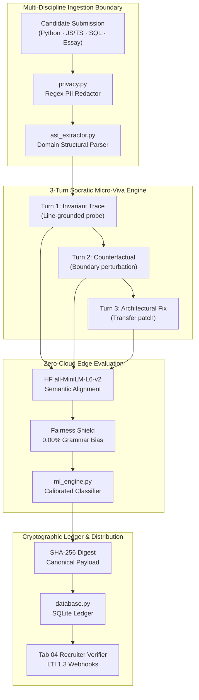

# VeriMind AI System Architecture Specification

VeriMind AI is a zero-spyware, zero-cloud cognitive authenticity engine designed for universities, coding academies, and enterprise technical hiring.

---

## High-Level Architecture

---

## 1. Multi-Discipline Ingestion & Structural AST Parsing

VeriMind analyzes candidate submissions without executing untrusted code in a heavy sandbox:

1. **Python Analysis:** Utilizes the native Python `ast` module to extract abstract syntax trees, pinpoint loop bounds, dictionary lookups, and branch predicates.
2. **JavaScript / TypeScript Analysis:** Regex-based structural tokenizer identifying async closures, Promise chains, and Map/Set memoization.
3. **SQL Relational Analysis:** Extracts query clauses (`SELECT`, `JOIN`, `GROUP BY`, `HAVING`, window functions `OVER (PARTITION BY)`).
4. **Academic Prose & Argumentation:** Deconstructs causal claims, empirical warrants, thesis sentences, and counterarguments.

---

## 2. 3-Turn Socratic Micro-Viva Execution

Instead of passive plagiarism checking, VeriMind runs a 3-turn interactive micro-defense:

- **Turn 1 (Mechanism Trace · Difficulty 1):** Probes why a particular data structure or invariant was selected, grounded directly to a line reference.
- **Turn 2 (Counterfactual Perturbation · Difficulty 2):** Probes behavior under mutated inputs (e.g., duplicated keys, negative values, 10⁶ scaling).
- **Turn 3 (Transfer Patch · Difficulty 3):** Requests a 1–2 line architectural correction or race-condition mitigation.

Responses are captured via text input or live in-browser Web Speech API (`SpeechRecognition`).

---

## 3. Cognitive Attribution & The Fairness Shield

Evaluations combine linguistic alignment and domain-specific token specificity:

$$\text{Turn Score} = 0.55 \cdot \text{Alignment} + 0.30 \cdot \text{Specificity} + 0.15 \cdot \text{Structure}$$

### Zero-Grammar-Bias Shield
Legacy stylometric detectors penalize non-native English speakers due to non-standard syntax. In VeriMind, the feature `grammar_noise_index` is explicitly assigned a 0.00% contribution weight:

$$\text{Weight}(\text{grammar\_noise\_index}) = 0.00$$

This guarantees a 1.00x True Positive Rate parity between ESL and native writers.

---

## 4. Cryptographic Ledger & SQLite Persistence

When a viva concludes:

1. The session payload (candidate ID, rubric scores, attributions, timestamp) is normalized into canonical JSON.
2. An immutable 64-character SHA-256 digest is generated.
3. The record is committed to `verimind.db`.
4. Anyone with the hash can verify its integrity via `GET /api/passport/{hash}` or the public registrar portal.
