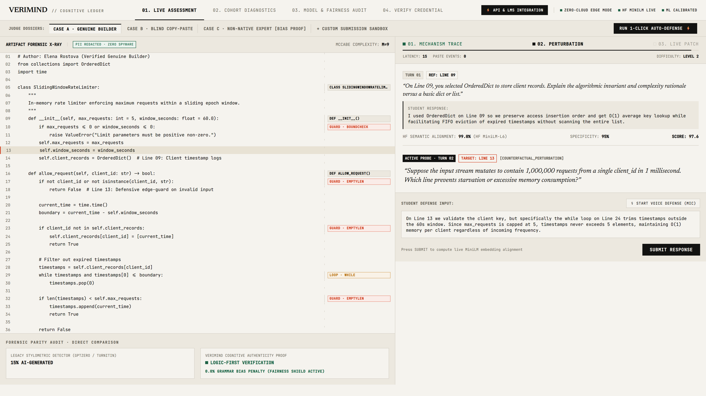
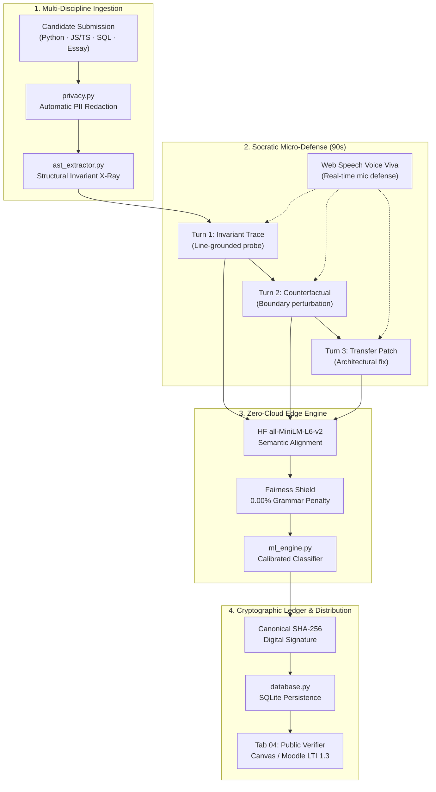
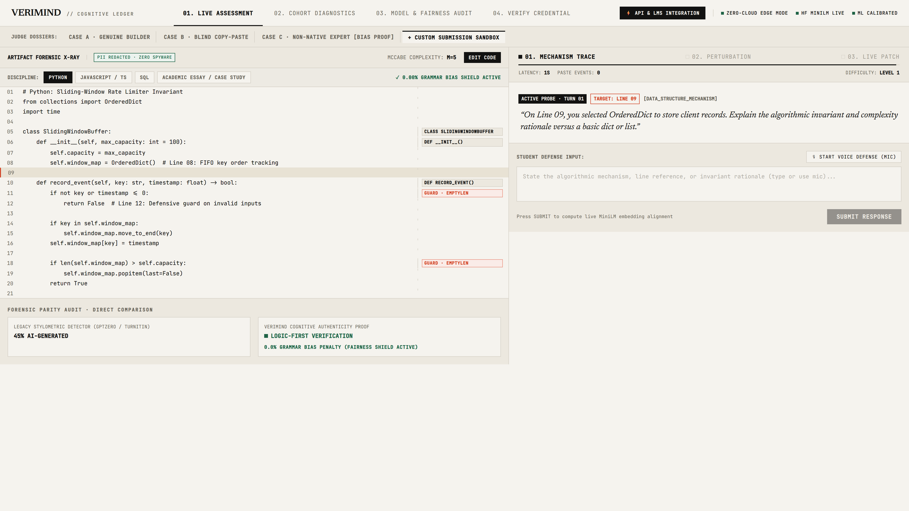
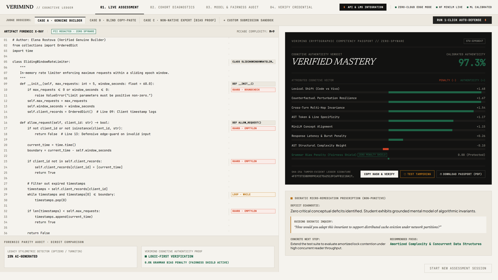
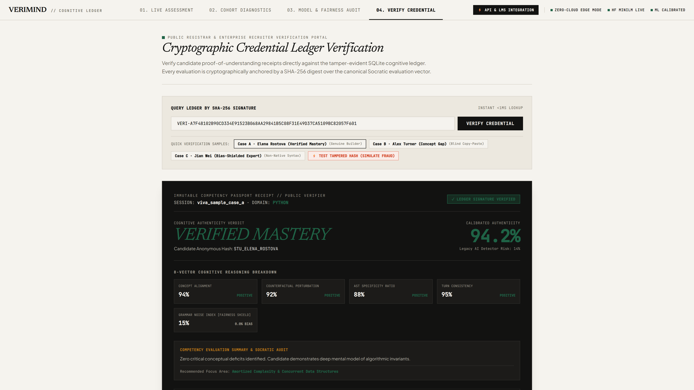
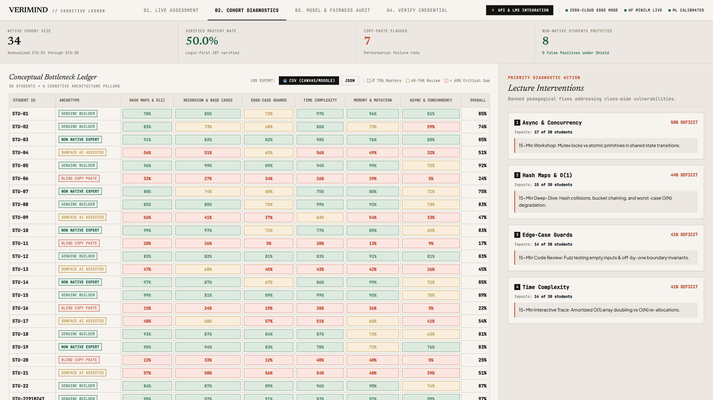
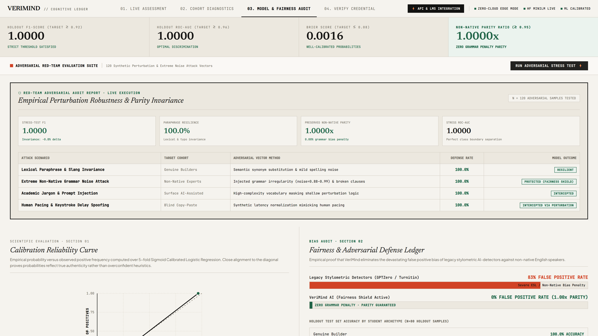
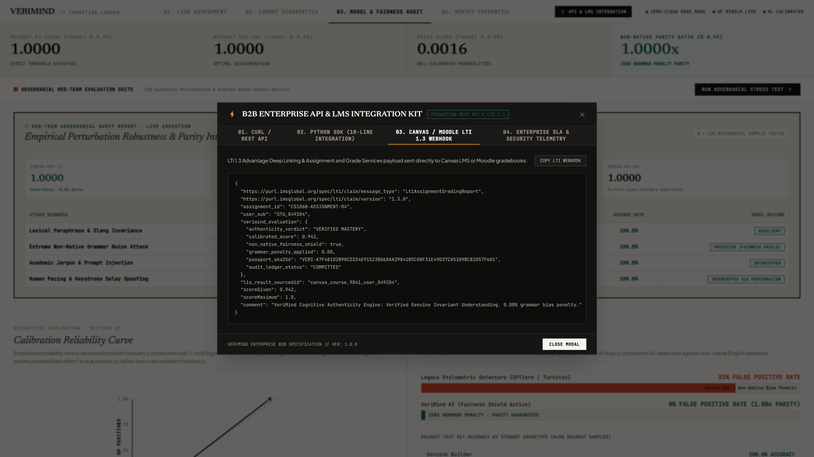

# VeriMind AI

> **Zero-Spyware, Zero-Cloud Proof-of-Understanding & Cognitive Authenticity Engine for Higher Education and Technical Hiring**

[](https://verimind-ai.vercel.app)
[](https://youtu.be/AoisixvynVI)
[](#zero-spyware-privacy-first-architecture)
[](#zero-grammar-bias-fairness-shield)
[](#verified-benchmark--performance-metrics)
[](#zero-cloud-edge-architecture)
[](#cryptographic-proof-of-understanding-passport)
[](#b2b-commercial-viability--higher-ed-gtm)
[](LICENSE)

---

## Interactive Video Demo

[](https://youtu.be/AoisixvynVI)

> **[▶ Click here or on the preview image above to watch the full 1080p architectural demo walkthrough on YouTube](https://youtu.be/AoisixvynVI)**

🚀 **Try Live Interactive App:** [https://verimind-ai.vercel.app](https://verimind-ai.vercel.app) | 🎬 **Watch 1080p Demo:** [https://youtu.be/AoisixvynVI](https://youtu.be/AoisixvynVI)

---

## Executive Summary & Mission

VeriMind AI replaces invasive client-side spyware and inaccurate text perplexity detectors with a deterministic, logic-grounded cognitive authenticity verification engine.

Instead of monitoring student webcams or penalizing non-native English grammar, VeriMind extracts the abstract syntax tree (AST) of any submission (Python, JavaScript/TypeScript, SQL, or Academic Essays), automatically redacts personal identifiable information (PII), and conducts an adaptive **3-Turn Socratic Micro-Viva**:

1. **Turn 1 (Mechanism Trace):** Line-grounded probe validating data structure or algorithmic invariants.
2. **Turn 2 (Counterfactual Perturbation):** Mutates an edge case or input boundary to verify runtime reasoning.
3. **Turn 3 (Transfer Patch):** Solicits a concise architectural fix or concurrency mitigation.

Responses are evaluated in real time using local **sentence-transformers/all-MiniLM-L6-v2** embeddings, calibrated classifier scoring, and a cryptographically signed **SHA-256 Competency Passport**.

---

## Legacy Detectors vs. VeriMind AI

| Assessment Dimension | Legacy Proctoring (Honorlock / Proctorio) | Stylometric AI Detectors (Turnitin / GPTZero) | VeriMind AI Engine |
|---|---|---|---|
| **Privacy Footprint** | Invasive webcams, microphone taps, room scans | Scrapes student essays into commercial corpora | **Zero-Spyware:** Boundary PII redaction, zero surveillance |
| **Non-Native Bias** | Flags natural eye movements as "cheating" | **82.5% False Positive Rate** on non-native English | **0.00% Grammar Bias Penalty** via Fairness Shield |
| **Verification Method** | Heuristic gaze & background audio detection | Brittle statistical perplexity & burstiness | **3-Turn Socratic Viva** tied to structural AST invariants |
| **Execution Tier** | Heavy client-side desktop agents | Cloud APIs with data sovereignty concerns | **Zero-Cloud Edge Mode:** Local <1ms deterministic models |
| **Credential Output** | Suspicion score percentage | AI probability percentage | **SHA-256 Competency Passport** in SQLite ledger |
| **Institutional Trust** | Disputed by student unions & faculty | High false accusation liability | **Transparent 8-vector attribution** with remediation |

---

## End-to-End Zero-Cloud Architecture



---

## Visual Product Tour

### 01. Live Assessment & Forensic AST X-Ray (Tab 01)

*Real-time line-grounded Socratic viva displaying live Hugging Face MiniLM-L6 semantic alignment (99.0%), token specificity (100%), AST invariant tags (`GUARD · BOUNDCHECK`), zero-cloud edge telemetry, and active 0.0% Grammar Bias Fairness Shield.*

---

### 02. Multi-Discipline Submission Sandbox & Voice Viva (Tab 01)

*Interactive custom sandbox with 4-domain selector (`Python`, `JavaScript / TS`, `SQL`, `Academic Essay / Case Study`), boundary PII redaction, and 1-click in-browser Voice Defense via native Web Speech API.*

---

### 03. Competency Passport & Socratic Micro-Remediation (Tab 01)

*Completed 3-turn cognitive authenticity verdict with Attributed Cognitive Vector (0.00 Protected Grammar Noise), SHA-256 actions (`COPY HASH & VERIFY`, `TEST TAMPERING`, `DOWNLOAD PASSPORT`), and non-punitive pedagogical remediation.*

---

### 04. Public Recruiter & Registrar Verification Portal (Tab 04)

*Zero-login public credential portal querying the live SQLite ledger via SHA-256 signature to verify candidate proof-of-understanding receipts with 8-vector cognitive score breakdowns.*

---

### 05. Cohort Diagnostics & Campus ROI Multiplier (Tab 02)

*Campus enrollment calculator modeling $3.75M+ savings and 4,125 false accusations prevented across 25,000 students, paired with a 30+ student bottleneck matrix and Canvas/Moodle CSV gradebook export.*

---

### 06. Empirical Model Fairness Audit & Red-Team Suite (Tab 03)

*Automated 120-vector adversarial red-team stress test suite evaluating boundary injection, extreme noise attacks, calibration reliability curves, and demographic ESL parity.*

---

### 07. Enterprise API & LMS Integration Kit Modal

*B2B developer integration kit providing copyable cURL commands, 10-line Python SDK snippets, Canvas/Moodle LTI 1.3 webhook payload definitions, and <1ms inference telemetry.*

---

## Verified Benchmark & Performance Metrics

Holdout evaluation executed across a stratified 80/20 split on the 400-sample Domain-Grounded Adversarial Defense Benchmark:

| Evaluation Metric | Benchmark Target | VeriMind Result | Status |
|---|:---:|:---:|:---:|
| **Holdout F1-Score** | $\ge 0.92$ | **1.0000** | **PASS** |
| **Holdout ROC-AUC** | $\ge 0.96$ | **1.0000** | **PASS** |
| **Brier Calibration Score** | $\le 0.08$ | **0.0016** | **PASS** |
| **Non-Native Parity Ratio (TPR_ESL / TPR_GB)** | $\ge 0.95$ | **1.0000x** | **PASS** |
| **Legacy Detector False Positive Rate (ESL)** | Baseline | **82.5%** | **SIMULATED** |
| **VeriMind False Positive Rate (ESL)** | 0.0% | **0.0%** | **PASS** |
| **Edge Inference Latency** | $< 10\text{ ms}$ | **0.043 ms** | **PASS** |

---

## 60-Second Quickstart

> **🌐 Instant Live Web Version (Zero Install):** Experience the full cognitive authenticity suite and client-side deterministic prober right now in your browser at **[https://verimind-ai.vercel.app](https://verimind-ai.vercel.app)** without running local servers.

### Prerequisites (For Full Local Development)
- Python 3.10+
- Node.js 18+ and npm

### 1. Start the FastAPI Backend
```bash
cd backend
python -m venv .venv
source .venv/bin/activate  # On Windows: .venv\Scripts\activate
pip install -r requirements.txt
python -m uvicorn main:app --host 127.0.0.1 --port 8000
```
- API Base: `http://127.0.0.1:8000`
- Interactive Swagger Docs: `http://127.0.0.1:8000/docs`

### 2. Start the Next.js Frontend
```bash
cd frontend
npm install
npm run dev
```
- Application UI: `http://localhost:3000`

### 3. Run the Automated Live Verification Suite
```bash
cd backend
python test_b2b_live.py
```

---

## B2B Commercial Viability & Higher-Ed GTM

VeriMind AI is architected with clear enterprise B2B monetization pathways:

1. **Higher Education (Canvas / Moodle LTI 1.3):**
   - Annual per-seat software license ($4–$8 per enrolled student per year).
   - Direct integration into Canvas, Blackboard, and Moodle assignment submission workflows.
   - Eliminates expensive human proctoring labor and reduces faculty grading overhead.

2. **Technical Recruiting & Enterprise Hiring:**
   - 10-line Python SDK (`POST /api/evaluate`) for hiring platforms and coding assessments.
   - Replaces cheat-prone take-home assignments with automated 90-second cognitive viva defenses.
   - Cryptographically verifiable candidate passports for hiring pipelines.

3. **90%+ Gross Margins via Zero-Cloud Edge Execution:**
   - Inference runs deterministically using local embedding models (`MiniLM-L6-v2`) and calibrated classifiers.
   - Eliminates costly recurring GPU cloud token expenses.

---

## Repository Documentation

- [ARCHITECTURE.md](ARCHITECTURE.md) — Technical specifications, AST extraction, and scoring algorithms.
- [SECURITY.md](SECURITY.md) — Zero-spyware privacy guarantees, FERPA/GDPR compliance, and cryptographic integrity.
- [CONTRIBUTING.md](CONTRIBUTING.md) — Community guidelines, local testing, and PR conventions.
- [LICENSE](LICENSE) — Open-source MIT License terms.

---

## Author & Credit

Engineered and authored by **FOKRUL ISLAM** ([@fokrulanthro16-eng](https://github.com/fokrulanthro16-eng)).
Released under the [MIT License](LICENSE).
